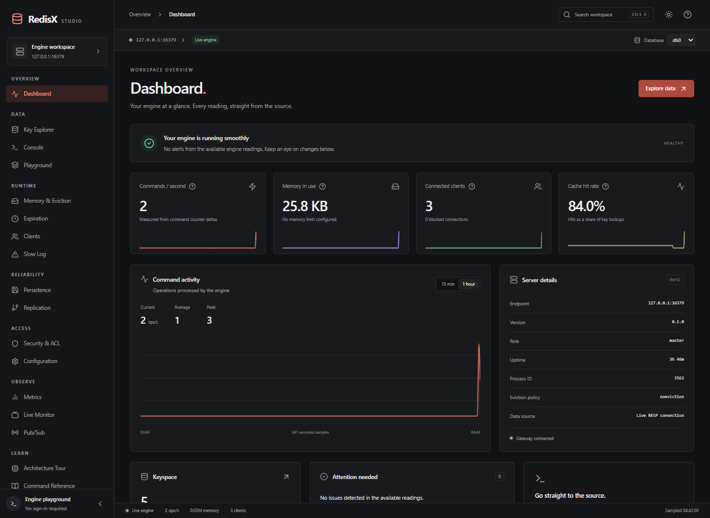
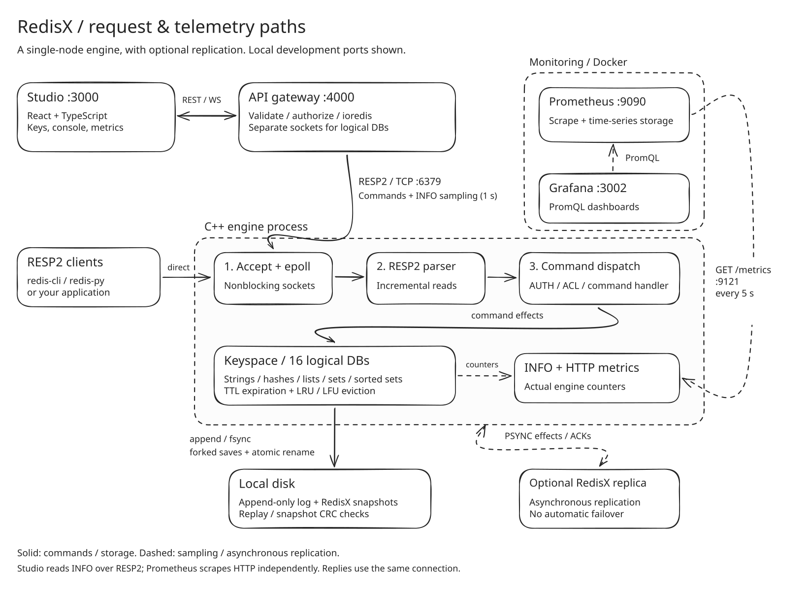

# RedisX (pbRedisDB)

A C++20 in-memory database with a browser workspace for inspecting the engine that actually stores your data.

RedisX speaks RESP2 over TCP and implements strings, hashes, lists, sets, and sorted sets. Studio connects through a Fastify gateway: a key created in the browser can be read by a Redis client against the same C++ process. The project includes expiration, eviction, append-only persistence, snapshots, optional primary/replica replication, and Prometheus metrics.

[Architecture](#architecture) · [Run locally](#run-locally) · [Try it](#try-it) · [Monitoring](#monitoring) · [Verification](#verification) · [Limitations](#limitations)

## What is here

- **A working storage engine.** Linux `epoll`, incremental RESP parsing, 16 logical databases, TTL expiration, and LRU/LFU eviction.
- **An inspectable data path.** Key Explorer, typed editors, a command console, and a playground that executes allowed commands in DB15.
- **Recoverable local state.** An append-only log and CRC-checked RedisX snapshots, with restart and corruption checks in the engine audit.
- **Measured observability.** INFO-based Studio readings, an HTTP metrics endpoint, Prometheus collection, and a provisioned Grafana dashboard.

This is a Redis-compatible subset, not a complete Redis implementation. The [compatibility boundaries](#limitations) are part of the project contract.



*Studio during local verification with a small test dataset. This screenshot is a functional example, not a throughput benchmark.*

## Architecture



[Open the diagram](docs/architecture/redisx.svg) · [Editable Excalidraw source](docs/architecture/redisx.excalidraw) · [Diagram notes](docs/architecture/README.md)

The main paths have different responsibilities:

1. **Commands:** Studio sends same-origin HTTP requests through the frontend proxy. The gateway validates requests, applies access rules, and sends RESP2 commands through ioredis. Logical databases use separate connections so concurrent requests cannot change each other's selected database.
2. **Storage:** the C++ reactor reads requests, parses them, and dispatches handlers against the keyspace. Applied mutations feed persistence and the replication stream. Background snapshot saves and AOF rewrites use forked children; `everysec` fsync currently runs on the maintenance tick.
3. **Telemetry:** Studio samples INFO through the gateway every second. Prometheus independently pulls the engine's HTTP `/metrics` endpoint every five seconds in the supplied local configuration. Grafana queries Prometheus. Changing Studio's connection does not retarget Prometheus.

A shared gateway currently has one configured engine target. The drawing shows the native/WSL engine with monitoring in Docker; the full-container configuration uses Docker service names instead.

## Run locally

The verified development setup runs the C++ engine in Linux or WSL, Studio on the host, and monitoring in Docker Desktop. Native Windows builds of the engine are not supported.

**Requirements:** a C++20 compiler, CMake 3.20+, Ninja, OpenSSL development headers, Node.js/npm, and optionally Docker Desktop. The recent Studio checks used Node.js 24.14.0 and Chrome 155 on Windows; the engine ran under WSL2. GoogleTest is fetched when C++ tests are enabled.

### 1. Start the C++ engine

Run from the repository root in a Linux or WSL terminal:

```bash
sudo apt-get update
sudo apt-get install -y build-essential cmake ninja-build libssl-dev openssl python3

cmake -S . -B build/local -G Ninja \
  -DCMAKE_BUILD_TYPE=Release \
  -DREDISX_BUILD_TESTS=OFF \
  -DREDISX_BUILD_BENCHMARKS=OFF
cmake --build build/local --parallel 2

mkdir -p data/local
./build/local/redisx \
  --bind 127.0.0.1 \
  --port 6379 \
  --metrics-port 9121 \
  --dir ./data/local \
  --appendonly yes
```

If an engine already owns port 6379, use that process or choose another port and set Studio's `REDIS_PORT` accordingly. Use a fresh build directory after moving the checkout; old CMake caches can contain absolute paths.

### 2. Start Studio

In PowerShell, from the same repository root:

```powershell
npm ci --prefix studio/gateway
npm ci --prefix studio/web

$env:NODE_ENV = 'development'
$env:HOST = '127.0.0.1'
$env:STUDIO_PLAYGROUND = 'true'
$env:REDIS_HOST = '127.0.0.1'
$env:REDIS_PORT = '6379'
$env:DEMO_MODE = 'false'
$env:DEMO_FALLBACK = 'false'

npm run dev
```

Open [Studio](http://localhost:3000/dashboard). The connection strip should say **Live engine**. [Gateway health](http://localhost:4000/health) should report `redis.status: connected` and `redis.isDemo: false`.

The explicit environment settings above disable the development file's automatic demo fallback. To explore sample data deliberately, use **Use demo** in connection settings; Studio labels that source.

### Local access and configuration

The local playground opens without sign-in only when all four conditions hold: `STUDIO_PLAYGROUND=true`, development mode, a loopback bind address, and a direct loopback peer. Authenticated deployments retain JWT sessions and viewer/operator/admin roles. These local settings are not a production security configuration.

The gateway reads shell environment variables first, then its selected `.env` file. See [.env.example](.env.example) and [the environment schema](studio/gateway/src/config/env.ts) for connection, TLS, access, and CORS settings. One connection change affects all users of that gateway.

## Try it

In Studio's **Console**, run one command at a time:

```redis
PING
SET readme:message "hello from C++" EX 120
GET readme:message
HSET readme:user name Ada role engineer
LPUSH readme:queue first second
SADD readme:tags cpp database
ZADD readme:scores 100 player1 200 player2
SCAN 0 MATCH readme:* COUNT 100
```

`PING` should return `PONG`; `GET` should return `hello from C++`. Open Key Explorer to inspect the five key types. The string expires after two minutes. These writes use the database selected in Studio.

With `redis-cli` installed, read the same value directly from the engine:

```bash
redis-cli -h 127.0.0.1 -p 6379 -n 0 GET readme:message
```

Select DB0 in Studio for this exact comparison. Cleanup removes only the example keys:

```redis
DEL readme:message readme:user readme:queue readme:tags readme:scores
```

## Monitoring

With the native/WSL engine running on port 6379 and its metrics endpoint on 9121:

```powershell
docker compose -p pbredisdb -f docker-compose.monitoring.yml up -d --wait
```

| Service | Address | Use |
| --- | --- | --- |
| Studio | [localhost:3000](http://localhost:3000/metrics) | Live readings and the guided monitoring walkthrough |
| Gateway | [localhost:4000/health](http://localhost:4000/health) | Engine connection and access mode |
| Engine exporter | [localhost:9121/metrics](http://localhost:9121/metrics) | Raw Prometheus-format engine counters |
| Prometheus | [localhost:9090/targets](http://localhost:9090/targets) | Target health and metric queries |
| Grafana | [localhost:3002](http://localhost:3002/d/redisx-overview/redisx-overview) | Provisioned RedisX overview |

The Metrics page has **Open Prometheus**, **Open Grafana**, and a three-step **Quick start** with copyable commands and expected results. Start with `up{job="redisx"}` in Prometheus; `1` means the scrape succeeded.

The monitoring-only Compose file targets `host.docker.internal:9121`. The full Docker stack targets `redisx:9121`. Named volumes retain monitoring history. If the repository moves, recreate monitoring containers from the new checkout so bind mounts point to the right files. See [monitoring setup and troubleshooting](docs/monitoring.md).

Studio's charts use gateway history held in memory, up to 48 hours including comparison windows. Grafana uses Prometheus history. Studio displays measured INFO round-trip time when command percentiles are unavailable; older engines without network counters show measured **Studio connection traffic**, which excludes other clients.

## Verification

These are local results, not a hosted release certification. Commands, evidence, environment, and scope are recorded in [the verification report](docs/verification.md).

| Check | Recorded result | Scope |
| --- | --- | --- |
| Gateway and frontend tests | **88 passed: 38 gateway + 50 frontend** | Request validation, access boundaries, data parsing, editors, history bounds, and formatter reuse |
| Studio → C++ integration | **16 checks passed** | All five key types, direct RESP agreement, TTL preservation, deletion, concurrent DB isolation, telemetry, and DB15 execution |
| Browser workflows | **6 passed; 18 routes exercised** | CRUD/TTL, console, disconnects, Metrics controls, monitoring walkthrough, themes, and mobile layout |
| Metrics memory stress | **1 passed with a 10,000-point fixture and a 128 MiB JS heap limit** | Comparisons, scrolling, hidden tabs, repeated route navigation, and memory bounds |
| C++ Debug / ASan+UBSan / TSan | **94/94 in each recorded run** | Engine audit results from 19 October 2026; includes a grouped real-server audit |
| RESP parser fuzzing | **419,081 executions in 301 seconds** | Recorded sanitizer run with no detected crash; bounded parser coverage |

A Metrics crash investigation also produced a reproducible measurement: renderer private memory reached **1,601 MiB in about 10 seconds** before the fix. After formatter reuse, bounded data, and chart visibility changes, the same live-page profile stayed around **150–230 MiB over one minute**, without forced garbage collection. This is a diagnostic observation on one machine, not a universal memory budget. [Before/after evidence and procedure](docs/metrics-memory.md).

The current production build reports **81.7 KiB gzip for initial public-route JavaScript**. That measurement excludes the later Studio, charts, and editor chunks; it is not the download size of the whole application.

### Run the checks

```powershell
npm run typecheck
npm test
npm run build

# The app and engine must already be running.
$env:STUDIO_URL = 'http://localhost:3000'
$env:ENGINE_PORT = '6379'
npm run test:studio
npm --prefix studio/web run test:metrics-memory
```

The native integration verifier expects a separate, freshly built engine on port 16379 by default. It creates uniquely named temporary keys and cleans them up:

```powershell
$env:ENGINE_PORT = '16379'
npm run verify:engine
```

For C++ checks in Linux/WSL, use the [testing guide](docs/testing.md). A minimal build without benchmark dependencies is:

```bash
cmake --preset debug -DREDISX_BUILD_BENCHMARKS=OFF
cmake --build --preset debug --parallel 2
ctest --preset debug --output-on-failure
```

The [Studio workflow](.github/workflows/studio.yml) contains the isolated engine, gateway, browser, and memory-test launch sequence. The [engine workflow](.github/workflows/ci.yml) runs Debug and sanitizer builds. Their configuration is included; hosted CI results were not verified for this README.

## Limitations

- **Protocol and commands:** RESP2 is supported; RESP3 and complete Redis command parity are not. Check `COMMAND LIST` on the actual engine. Lua, Redis modules, Redis Cluster, Streams, Geo, and HyperLogLog are outside the implemented scope.
- **Persistence:** snapshots use the RedisX format, not Redis RDB. `everysec` fsync can stall the event loop on slow storage. The completed tests do not establish a power-loss durability guarantee or a production recovery-time objective.
- **Replication:** primary/replica streaming is implemented; automatic failover, Redis Cluster routing, and upstream replica AUTH/TLS are not. Full sync serializes a snapshot synchronously.
- **Memory:** engine accounting estimates tracked dataset allocations, not total process RSS. `maxmemory` is not a hard process-memory ceiling. Browser profiling is a separate measurement.
- **Studio:** capability-dependent operations can return an explicit unsupported response. Live MONITOR, snapshot inspection, and replication preflight remain unavailable in the verified path. Shared-socket transactions are blocked in the console; the native engine has separate transaction tests.
- **Evidence:** no current-code throughput benchmark or 100,000-key/60 FPS certification is claimed. [Older benchmark reports](docs/benchmarks.md) remain available as historical material.

## Source map

```text
src/                    C++ runtime and command implementations
include/redisx/         Engine interfaces and data structures
studio/gateway/         Fastify API, RESP client, safety rules, metrics sampler
studio/web/             React workspace, public site, browser tests
tests/                  C++ unit, process, compatibility, property, and fuzz checks
infra/                  Container builds, engine configs, monitoring provisioning
docs/architecture/      SVG export and editable Excalidraw scene
docs/evidence/          Small, checked-in verification records
tools/                  Workspace launcher and command-line utilities
```

## Further reading

- [Verification results and evidence](docs/verification.md)
- [Engine audit and compatibility boundaries](docs/engine-audit.md)
- [Persistence format and recovery behavior](docs/persistence-format.md)
- [Replication protocol and limitations](docs/replication.md)
- [Studio implementation review](docs/studio-review.md)
- [Monitoring setup](docs/monitoring.md)
- [Metrics memory regression](docs/metrics-memory.md)

## Contributing

Keep changes focused and include the check that exercises the behavior being changed. Engine changes should run the relevant CTest cases; UI and gateway changes should run the relevant npm and browser checks. Include the command, environment, and raw output when adding a performance claim. Do not treat a benchmark result, a model test, or a successful smoke test as a broader correctness guarantee.

## License

The existing project documentation declares MIT licensing. A standalone `LICENSE` file is not present in this checkout.
