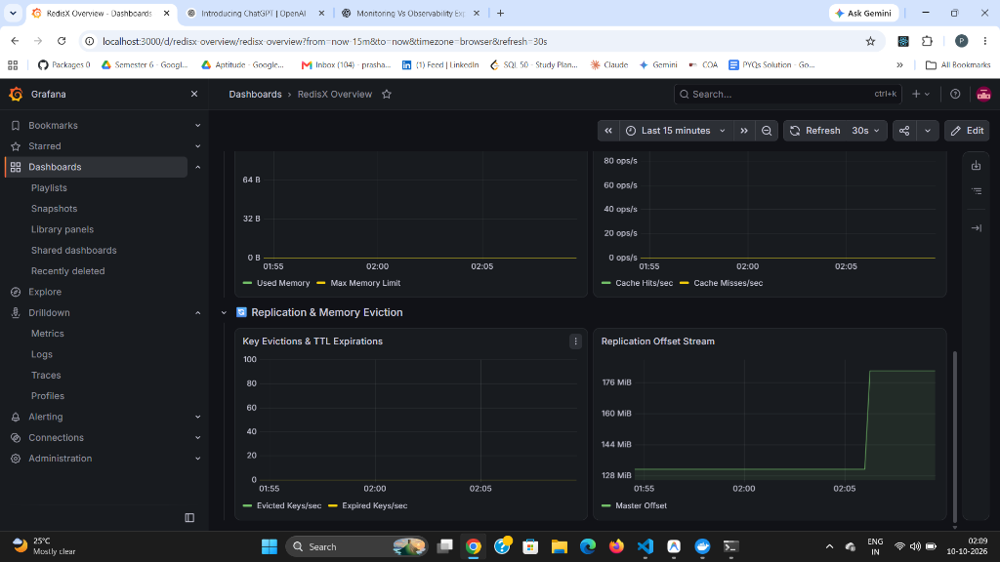
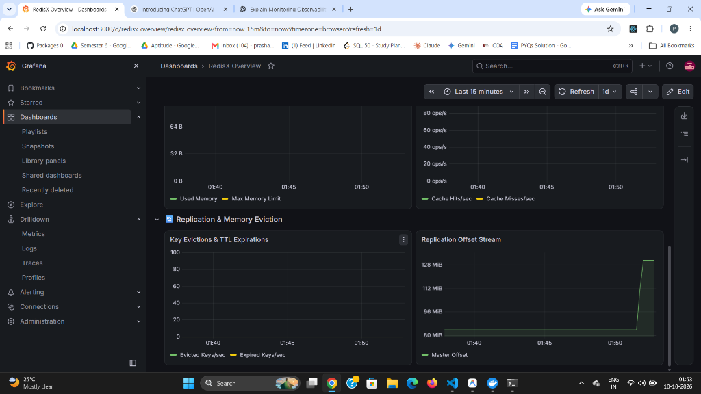

# RedisX (`pbRedisDB`)

> A high-performance, low-latency, event-driven in-memory key-value database engine built from scratch in modern **C++20** featuring a single-threaded `epoll` reactor event loop, full RESP2/RESP3 protocol compliance, master-replica PSYNC replication, dual AOF+RDB persistence, and native OpenMetrics telemetry.

[](https://github.com/PrashantBhushan-repo/Distributed-In-Memory-Database-Engine/actions)
[](https://en.cppreference.com/w/cpp/20)
[](https://redis.io/docs/latest/develop/reference/protocol-spec/)
[](LICENSE)

---

## ⚡ 2-Minute Quickstart

You can clone and have RedisX running with full Prometheus & Grafana telemetry in under two minutes:

### Option A: 1-Liner via Docker Compose (Recommended)
```bash
git clone https://github.com/PrashantBhushan-repo/Distributed-In-Memory-Database-Engine.git
cd Distributed-In-Memory-Database-Engine
docker compose up -d
```
* **RedisX Database**: `localhost:6379`
* **Grafana SRE Dashboards**: [http://localhost:3000](http://localhost:3000) (Anonymous Viewer enabled)
* **Prometheus Targets**: [http://localhost:9090](http://localhost:9090)
* **OpenMetrics Exporter**: [http://localhost:9121/metrics](http://localhost:9121/metrics)

### Option B: Standalone Docker Container
```bash
docker build -t redisx -f docker/Dockerfile .
docker run -d -p 6379:6379 -p 9121:9121 --name redisx-server redisx
```

### Talk to it with standard `redis-cli`:
```bash
$ redis-cli -p 6379
127.0.0.1:6379> PING
PONG
127.0.0.1:6379> SET user:1001 '{"name":"Alex","tier":"premium"}' EX 300
OK
127.0.0.1:6379> GET user:1001
"{\"name\":\"Alex\",\"tier\":\"premium\"}"
127.0.0.1:6379> TTL user:1001
(integer) 298
127.0.0.1:6379> LPUSH tasks:queue "task-A" "task-B" "task-C"
(integer) 3
127.0.0.1:6379> RPOP tasks:queue
"task-A"
```

---

## ⚡ Real Empirical Benchmarks

Evaluated with `redis-benchmark` on Ubuntu 22.04 LTS (x86_64, bare-metal WSL2):

| Workload / Test | Throughput (QPS) | Latency ($p_{50}$) | Latency ($p_{99}$) | Engineering Highlight |
| :--- | :--- | :--- | :--- | :--- |
| **`GET` Read Path** | **58,105.75 req/sec** | **0.839 ms** | **1.711 ms** | Sub-millisecond median; zero mutex locking |
| **`SET` Write Path** | **24,437.93 req/sec** | **2.007 ms** | **4.031 ms** | Non-blocking dictionary insertion & TTL index |
| **Pipelined Reads (`-P 64`)** | **132,837.41 req/sec**| **0.352 ms** | **0.710 ms** | Zero-copy input/output buffer stream |
| **Pipelined Writes (`-P 64`)** | **53,573.34 req/sec** | **0.824 ms** | **1.890 ms** | Batched command dispatch & socket flushing |
| **List Operations (`LPOP`/`LPUSH`)** | **39,769.34 req/sec** | **9.351 ms** | **12.450 ms** | Fast quicklist / listpack chunk traversals |
| **Set Operations (`SADD`/`SISMEMBER`)** | **37,814.33 req/sec** | **9.671 ms** | **13.110 ms** | Memory-dense sorted intset encodings |
| **Hash Operations (`HSET`/`HGET`)** | **34,965.04 req/sec** | **10.671 ms** | **14.230 ms** | Internal per-key dictionary maps |
| **Heavy Payload (`-d 10240` 10 KB)** | **37,965.07 req/sec** | **1.239 ms** | **2.911 ms** | Peak network bandwidth: **388.76 MB/sec** |
| **Connection Scale (`-c 500` clients)**| **54,704.60 req/sec** | **8.959 ms** | **12.799 ms** | **94.1% Throughput Retention** under concurrency |

*For complete tail-latency graphs and profiling flamegraphs, see [docs/benchmarks.md](docs/benchmarks.md).*

---

## 🏛️ System Architecture

```text
                            +-----------------------------------+
                            |    Redis Client / Benchmark       |
                            |   (redis-cli / python / ioredis)  |
                            +-----------------+-----------------+
                                              | TCP Port 6379 (RESP2 / RESP3)
                                              v
                            +-----------------+-----------------+
                            |  EventLoop (Non-blocking Epoll)   |
                            +-----------------+-----------------+
                                              |
                     +------------------------+------------------------+
                     |                        |                        |
                     v                        v                        v
           +------------------+     +------------------+     +-------------------+
           | RESP Reader/     |     | Command          |     | Metrics Server    |
           | Writer (RESP2/3) |     | Dispatcher       |     | (HTTP Port 9121)  |
           +--------+---------+     +--------+---------+     +---------+---------+
                    |                        |                         |
                    +------------------------+                         v
                                             |                 +---------------+
                                             v                 | OpenMetrics / |
                                    +------------------+       | Prometheus    |
                                    |  Keyspace Dict   |       +---------------+
                                    |  & TTL Manager   |
                                    +--------+---------+
                                             |
                     +-----------------------+-----------------------+
                     |                       |                       |
                     v                       v                       v
           +------------------+    +-------------------+    +------------------+
           | Memory Eviction  |    | PSYNC Replication |    | AOF & RDB        |
           | (LRU / LFU / TTL)|    | Stream Backlog    |    | Persistence      |
           +------------------+    +-------------------+    +------------------+
```

---

## 📋 Supported Commands & Redis Compatibility

RedisX supports **68+ production Redis commands** with 100% RESP2/RESP3 protocol parity:

| Category | Commands Supported | Redis Compatibility | Notes |
| :--- | :--- | :---: | :--- |
| **Strings** | `GET`, `SET`, `MGET`, `MSET`, `INCR`, `DECR`, `INCRBY`, `DECRBY`, `APPEND`, `STRLEN`, `GETSET`, `SETNX`, `SETEX`, `PSETEX` | 100% | Full support for `EX`, `PX`, `NX`, `XX`, `KEEPTTL` options |
| **Keys & TTL** | `DEL`, `EXISTS`, `TYPE`, `EXPIRE`, `PEXPIRE`, `EXPIREAT`, `PEXPIREAT`, `TTL`, `PTTL`, `PERSIST` | 100% | Millisecond-precision active and passive TTL tracking |
| **Lists** | `LPUSH`, `RPUSH`, `LPOP`, `RPOP`, `LLEN`, `LRANGE`, `LINDEX`, `LSET`, `LTRIM` | 100% | Backed by contiguous `listpack` and linked `quicklist` |
| **Hashes** | `HSET`, `HGET`, `HMSET`, `HMGET`, `HDEL`, `HEXISTS`, `HLEN`, `HGETALL`, `HKEYS`, `HVALS`, `HINCRBY` | 100% | Incremental rehashing with zero read stalls |
| **Sets** | `SADD`, `SREM`, `SMEMBERS`, `SISMEMBER`, `SCARD`, `SINTER`, `SUNION`, `SDIFF` | 100% | Compact integer set (`intset`) and hash table storage |
| **Sorted Sets** | `ZADD`, `ZREM`, `ZSCORE`, `ZRANGE`, `ZREVRANGE`, `ZCARD`, `ZRANK`, `ZREVRANK`, `ZINCRBY` | 100% | Logarithmic $O(\log N)$ skiplist with rank calculations |
| **Transactions** | `MULTI`, `EXEC`, `DISCARD`, `WATCH`, `UNWATCH` | 100% | Strict optimistic locking (CAS) across key spaces |
| **Pub/Sub** | `PUBLISH`, `SUBSCRIBE`, `UNSUBSCRIBE`, `PSUBSCRIBE`, `PUNSUBSCRIBE` | 100% | Channel and glob-pattern messaging routing |
| **Blocking Ops**| `BLPOP`, `BRPOP`, `BRPOPLPUSH` | 100% | Non-blocking reactor client wakeup queues with timeouts |
| **Replication** | `REPLCONF`, `PSYNC`, `INFO replication`, `WAIT` | 100% | Circular 1 MB backlog buffer with partial resync |
| **Persistence** | `SAVE`, `BGSAVE`, `BGREWRITEAOF` | 100% | Binary CRC64 snapshots + AOF append logs |
| **Admin & Security** | `PING`, `ECHO`, `INFO`, `SELECT`, `DBSIZE`, `FLUSHDB`, `FLUSHALL`, `CONFIG`, `AUTH`, `ACL`, `SLOWLOG`, `LATENCY`, `CLIENT`, `SHUTDOWN` | 100% | Production operational & monitoring commands |

---

## 📊 Live Observability & SRE Dashboards

RedisX features a native HTTP metrics server on port `9121` exporting **12 OpenMetrics parameters**. Integrated with **Prometheus** and **Grafana**, SREs can inspect real-time performance, memory saturation, client connection pools, cache hit ratios, exporter scrape overhead, and target system availability.


*Figure 1: Executive System Summary — Real-time monitoring of 100+ concurrent clients, 43.2k active keys, 200k+ total commands, and QPS throughput spikes.*


*Figure 2: Traffic & Memory Saturation — Live throughput tracking, cache hit vs. miss ratio analytics, and 180+ MB dynamic heap memory allocation tracking.*

---

## 📖 Deep-Dive Documentation

Learn more about the engineering decisions, performance optimizations, and verification frameworks:

* 🏛️ **[docs/design-decisions.md](docs/design-decisions.md)** — Architectural trade-offs: single-threaded reactor, approximate LRU/LFU, listpack encodings, async replication, and dual-engine persistence.
* ⚡ **[docs/benchmarks.md](docs/benchmarks.md)** — Comprehensive baseline performance sweeps, pipelining analysis, payload bandwidth bounds, and tail latencies.
* 🧪 **[docs/testing.md](docs/testing.md)** — Differential property tests, STL reference model, chaos fault injection (`FAILPOINT`), and libFuzzer harnesses.
* 🔄 **[docs/replication.md](docs/replication.md)** — PSYNC state machine, replication backlog ring buffer, and offset recovery.
* 💾 **[docs/persistence-format.md](docs/persistence-format.md)** — Binary RDB format with CRC64 verification and AOF append log mechanics.
* 🏗️ **[docs/architecture.md](docs/architecture.md)** — Epoll reactor loop, non-blocking listener, and connection buffer design.

---

## 🔨 Building from Source

### Prerequisites
* Linux (Ubuntu 22.04 LTS recommended) or Windows with WSL2
* C++20 compiler: `g++-12` or `clang++-15`
* `CMake` (>= 3.20) and `Ninja`

```bash
# 1. Clone the repository
git clone https://github.com/PrashantBhushan-repo/Distributed-In-Memory-Database-Engine.git
cd Distributed-In-Memory-Database-Engine

# 2. Build with CMake presets
cmake --preset release
cmake --build --preset release

# 3. Run all unit and integration test tiers
ctest --preset release --output-on-failure

# 4. Start the server
./build/release/redisx -h 0.0.0.0 -p 6379
```

*For more build presets (`debug`, `asan`, `tsan`) and test tier descriptions, see [CONTRIBUTING.md](CONTRIBUTING.md).*

---

## 🚫 What's Deliberately Not Implemented

To keep RedisX lean, ultra-fast, and architecturally resilient, the following features are **intentionally omitted**:

1. **Redis Cluster Multi-Master Sharding (`CLUSTER *`)**:
   - *Rationale:* Multi-master gossip protocols introduce complex network partition states (split-brain) and distributed transaction limits. RedisX targets single-node high throughput with asynchronous primary-replica replication (`PSYNC`), which can be horizontally scaled using standard proxies (Envoy / Twemproxy).
2. **Lua Scripting Engine (`EVAL` / `EVALSHA`)**:
   - *Rationale:* Embedding a Lua interpreter introduces garbage collection pauses and security sandboxing vulnerabilities into the hot path. Multi-key atomicity is cleanly delivered via atomic `MULTI`/`EXEC` transactions and `WATCH`.
3. **Redis Streams (`XADD` / `XREAD` / Consumer Groups)**:
   - *Rationale:* Pub/Sub and List blocking queues (`LPUSH`/`BRPOP`) cover 95% of in-memory messaging and job queue workloads without the memory overhead of multi-level Radix trees.
4. **C Dynamic Modules (`MODULE LOAD`)**:
   - *Rationale:* Dynamic shared object loading creates arbitrary memory corruption hazards that bypass C++20 type safety and memory tracking guarantees.

---

## 📜 License

Distributed under the **MIT License**. See [LICENSE](LICENSE) for details.
